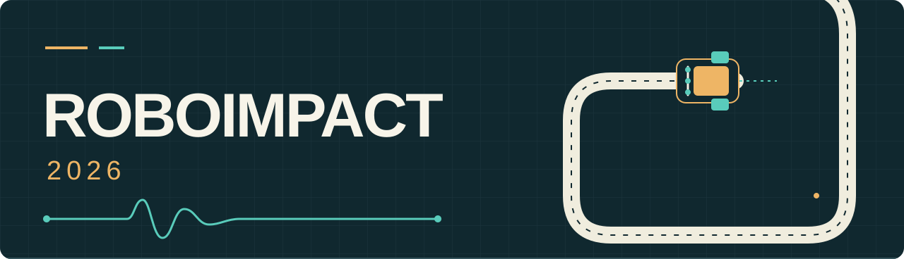
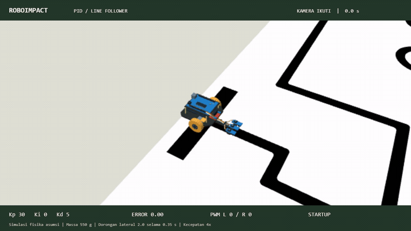

<p align="center">
  
</p>

<h1 align="center">ROBOIMPACT 2026</h1>

<p align="center">Dari pembacaan sensor sampai robot mengikuti garis.<br>Praktik Arduino, kontrol motor, dan eksperimen lewat simulator.</p>

<p align="center">
  <a href="code/README.md#mulai-praktik"><strong>Mulai praktik →</strong></a> ·
  <a href="#simulator">Jalankan simulator</a> ·
  <a href="hardware/README.md">Lihat wiring</a> ·
  <a href="Simulator/tests/README.md">Pengujian</a>
</p>

---

## Mulai praktik

**Baca sensor → uji motor → pilih controller → amati respons.**

1. **Ukur.** Jalankan [tes sensor](code/test/README.md#tes-sensor), lalu kalibrasikan threshold tiap sensor dari nilai putih dan hitam.
2. **Uji.** Jalankan [tes motor](code/test/README.md#tes-motor) untuk memastikan kanal kiri/kanan serta arah putaran roda.
3. **Jalankan.** Pilih [Bang-bang](code/line_follower_bang_bang/README.md) atau [PID](code/line_follower_pid/README.md), cocokkan wiring, lalu upload lewat Arduino IDE.

| Konfigurasi | Bang-bang · 2 sensor | PID · 3 sensor |
| --- | --- | --- |
| Input kiri → kanan | A3, A2 | A0, A1, A2 |
| Threshold awal | 400 / 400 | 300 / 300 / 300 |
| PWM dasar kiri / kanan | 68 / 68 | 60 / 60 |
| Serial Monitor | 9600 baud | 115200 baud |
| Sketch | [Buka Bang-bang](code/line_follower_bang_bang/line_follower_bang_bang.ino) | [Buka PID](code/line_follower_pid/line_follower_pid.ino) |

> [!IMPORTANT]
> Pin sensor kedua sketch berbeda. Motor tetap memakai kiri **IN10/9–EN11** dan kanan **IN8/7–EN6**. Cocokkan [wiring](hardware/README.md) sebelum berganti sketch.

Bang-bang maju ketika kedua sensor putih, belok ketika salah satu hitam, dan berhenti selama keduanya hitam. PID memakai gain awal **18/0,01/5**, bobot posisi **−2/0/2**, serta pencarian dasar saat garis hilang. Kedua sketch memiliki threshold yang bisa dikalibrasi per sensor.

## Simulator

Eksperimen dengan **tiga sensor**, dua roda, gangguan lateral, dan telemetri langsung. Bang-bang menjadi mode awal; PID serta bang-bang koreksi tetap tersedia untuk perbandingan.

```powershell
cd Simulator
npm ci
npm run dev
```

Buka [localhost:8765](http://127.0.0.1:8765). Jika dependensi sudah terpasang, cukup jalankan `npm run dev`. [Panduan simulator →](Simulator/README.md)

> [!NOTE]
> Browser memakai tuning, kompensasi deadzone, recovery, dan penilai finish dari model simulator. Aplikasi tidak meng-upload atau mengeksekusi sketch Arduino. Ukuran arena awal **2 × 2 m** masih merupakan asumsi skala PDF.

### Preview PID

[](Simulator/output/pid-follow-preview.mp4)

**Putar video →** [MP4 perjalanan PID](Simulator/output/pid-follow-preview.mp4). GIF dan MP4 ditayangkan **4×**, memakai gain simulator **30/0/5** dan massa estimasi **550 g**. Ini preview model, bukan hasil pengujian robot fisik.

## Isi repository

| Bagian | Yang ada di dalamnya |
| --- | --- |
| [code/](code/README.md) | Sketch aktif, tes komponen, dan ilustrasi P–I–D |
| [hardware/](hardware/README.md) | Wiring, daftar sambungan, generator diagram, dan SVG part |
| [Simulator/](Simulator/README.md) | Aplikasi Three.js, model robot, test, dan perekaman |
| [docs/](docs/README.md) | Keterangan track dan aset dokumentasi |

## Track dan wiring


[PDF sumber track](Simulator/public/Track.pdf) · [Keterangan track](docs/track/README.md) · [Wiring dan daftar sambungan](hardware/README.md)

Start mengikuti garis panjang dari sisi kiri atau kanan. Kedua sketch Arduino belum memiliki deteksi finish khusus; penilaian zona finish merupakan fitur simulator.

## Pengujian

```powershell
# Dari folder Simulator
npm test
npm run typecheck
```

[Laporan benchmark](Simulator/tests/REPO_SKETCH_RESULTS.md) pada model mencatat **18/18 run PID mencapai finish**. Bang-bang dua sensor berhenti sebelum finish pada **18/18 run**, sesuai keputusan stop ketika kedua sensor hitam. Hasil ini bukan build target Uno atau pengujian hardware.

[Panduan pengujian →](Simulator/tests/README.md) menjelaskan uji model, perbandingan C++ melalui mock Arduino, dan benchmark lintasan.

---

**ROBOIMPACT / 2026** · [Arduino](code/README.md) · [Simulator](Simulator/README.md) · [Hardware](hardware/README.md) · [Dokumentasi](docs/README.md)
