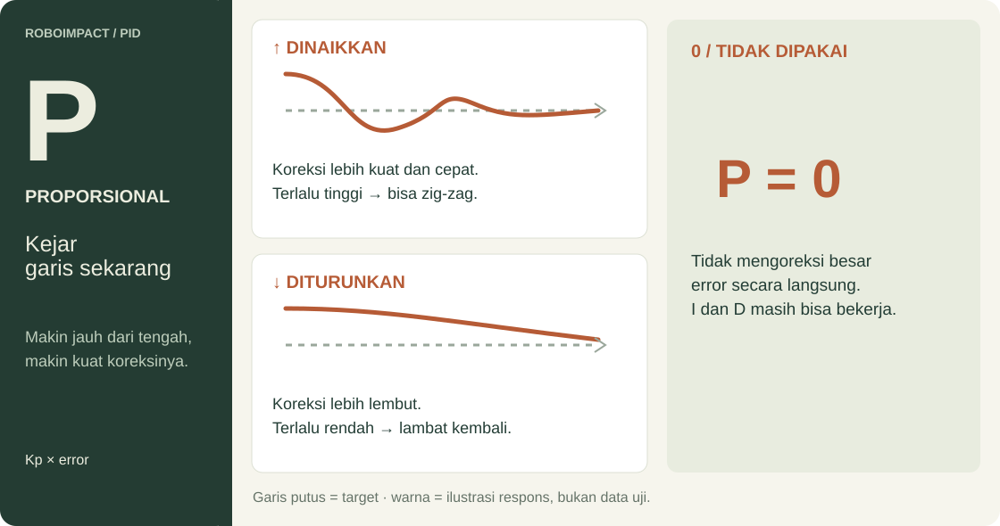
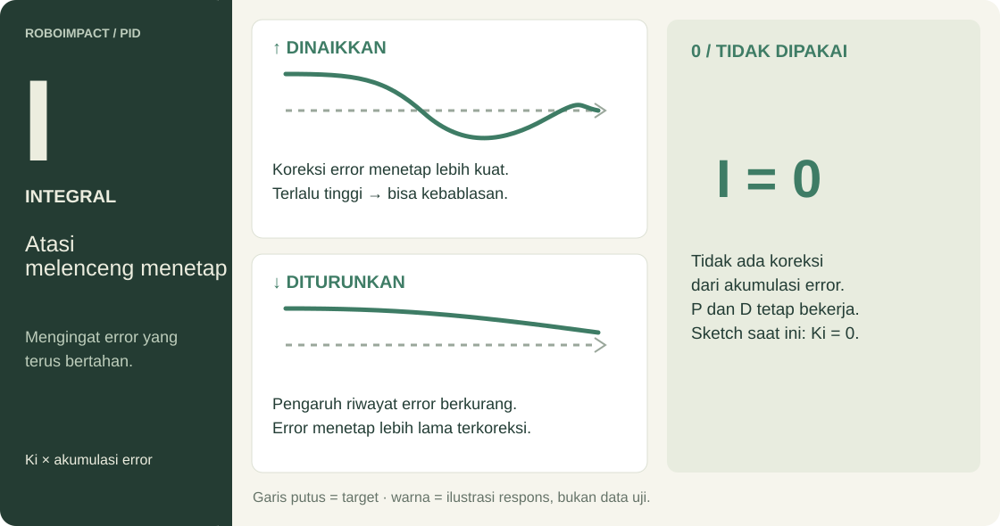
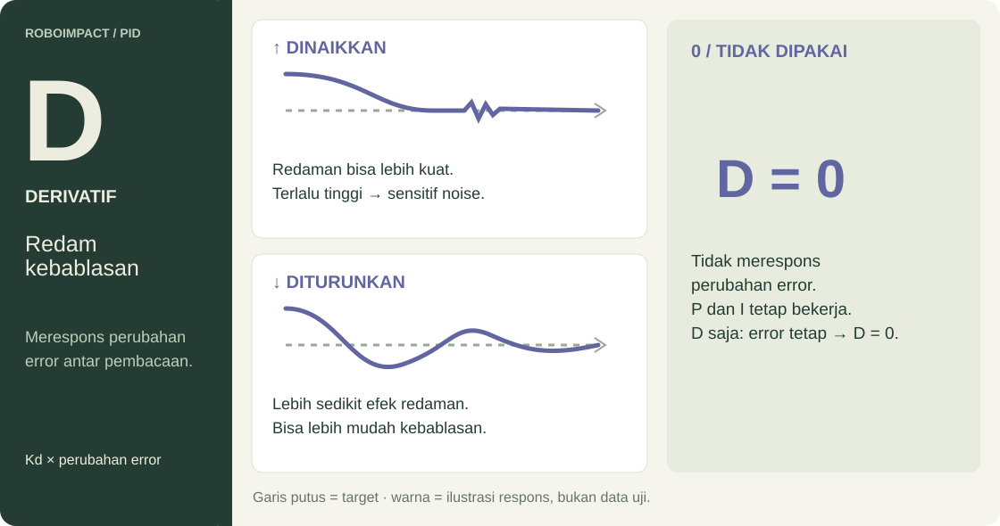

[ROBOIMPACT](../../README.md) / [Firmware](../README.md) / PID

<sub>ROBOIMPACT 2026 / FIRMWARE</sub>

# ROBOIMPACT · Line follower PID

[Sketch Arduino](line_follower_pid.ino) aktif memakai **tiga sensor A0/A1/A2** dan mengubah selisih kecepatan dua motor agar garis kembali berada di tengah sensor.

[Sketch Arduino](line_follower_pid.ino) · [Pengaturan](#wiring-dan-pengaturan-awal) · [Tuning PID](#panduan-pid) · [Lost-line](#lost-line) · [Wiring](../../hardware/README.md)

## Wiring dan pengaturan awal

| Komponen | Pin Uno |
| --- | --- |
| Sensor kiri / tengah / kanan, AO | A0 / A1 / A2 |
| Motor kiri IN1 / IN2 / ENA | 10 / 9 / 11 PWM |
| Motor kanan IN3 / IN4 / ENB | 8 / 7 / 6 PWM |

Gunakan diagram tiga sensor dalam [panduan hardware](../../hardware/README.md). Tes sensor memakai pin yang sama. Motor kiri memakai kanal A dan kanan kanal B; periksa kanal serta arah putaran lewat [tes motor](../test/README.md#tes-motor).

| Parameter | Nilai awal |
| --- | --- |
| Threshold kiri / A0 | `THRESHOLD_KIRI = 300` |
| Threshold tengah / A1 | `THRESHOLD_TENGAH = 300` |
| Threshold kanan / A2 | `THRESHOLD_KANAN = 300` |
| Gain | `Kp = 18`, `Ki = 0.01`, `Kd = 5` |
| PWM dasar kiri / kanan | 60 / 60 |
| Batas PWM tracking | 0–85 pada skala 0–255 |
| Serial Monitor | 115200 baud |

Kalibrasikan tiga threshold secara independen dari nilai putih/hitam tiap sensor. `setup()` menghentikan motor, mencetak `=== Robot Ready ===`, lalu menunggu satu detik. Keluaran Serial aktif menampilkan tiga ADC dalam urutan kiri, tengah, kanan.

## Panduan PID

### P · Koreksi posisi sekarang



### I · Koreksi error yang menetap



### D · Respons perubahan error



### Percobaan tuning

1. Mulai dengan **P**, lalu tambahkan **D**. Gunakan **I** bila masih ada error kecil yang menetap.
2. Ubah **satu gain** tiap percobaan. Di simulator, tekan **Reset** dan beri gangguan yang sama.
3. Bandingkan **zig-zag**, **kebablasan**, dan **waktu kembali ke garis**.

Gambar menunjukkan ilustrasi respons, bukan data uji. Hasil bergantung pada gain lain dan kondisi robot.

> [!NOTE]
> **Semua gain nol:** saat tracking, PWM menjadi 60/60 tanpa koreksi PID. Logika lost-line tetap bisa mengambil alih.

## Rumus dan implementasi

<details>
<summary>Buka detail pembobotan sensor dan perhitungan PID</summary>

```text
Baca sensor → hitung error → hitung koreksi PID → atur PWM motor → ulangi
```

`readSensors()` menganggap sensor aktif jika ADC **lebih besar dari threshold sensor tersebut**. Sensor kiri/tengah/kanan memiliki posisi `[-2, 0, 2]`; setiap sensor aktif menyumbang bobot sinyal `ADC - sensorThresholds[i]`:

```text
error = jumlah(posisi × bobot sinyal) / jumlah(bobot sinyal)
```

Targetnya `error = 0`, yaitu garis berada di tengah array sensor.

| Komponen | Peran | Implementasi sketch |
| --- | --- | --- |
| P | Mengoreksi error sekarang | `Kp × error` |
| I | Mengoreksi error yang terus bertahan | `Ki × integral`, dengan `integral += error`, dibatasi ±100 |
| D | Merespons perubahan error, dapat membantu mengurangi overshoot | `Kd × (error - lastError)` |

```text
pidOutput = P + I + D
PWM kiri  = constrain(int(60 + pidOutput), 0, 85)
PWM kanan = constrain(int(60 - pidOutput), 0, 85)
```

Contoh output `+20` menghasilkan PWM kiri/kanan 80/40. Arah belok fisiknya bergantung pada pemasangan motor dan urutan sensor. Angka PWM bukan RPM: batas 85 adalah perintah pada skala 0–255.

Integral dan derivative dihitung **per loop**, tanpa faktor waktu `dt`. `delay(1)` tidak menjamin periode loop tepat 1 ms karena pembacaan ADC dan keluaran Serial juga membutuhkan waktu.

</details>

## Lost-line

Jika semua sensor tidak aktif, robot mempertahankan koreksi lama terlebih dahulu, lalu mencari garis menurut arah terakhir yang tersimpan.

| Kondisi | Perilaku sketch Arduino |
| --- | --- |
| Garis hilang | `lineDetected = false`, integral direset, error lama dipertahankan |
| Kurang dari 1 detik sejak garis terakhir terlihat | Gunakan output PID lama tanpa menghitung ulang PID |
| Mulai 1 detik; arah pencarian `1` | PWM kiri/kanan 90/0 |
| Mulai 1 detik; arah pencarian `-1` | PWM kiri/kanan 0/90 |
| Mulai 1 detik; arah pencarian masih `0` | Pertahankan perintah motor sebelumnya |

PWM pencarian 90 ditulis langsung melalui fungsi motor, sehingga dapat melebihi batas tracking 85.

<details>
<summary>Batas logika lost-line saat pengujian</summary>

- Arah pencarian hanya diperbarui saat error **> 0,25** atau **< −0,25**, sehingga arah tersimpan bisa kedaluwarsa.
- Jika arah masih nol, motor tidak menerima perintah baru; saat startup motor bisa tetap diam.
- Pencarian belum memiliki timeout.
- Derivative tidak direset saat garis ditemukan kembali.

</details>

## Batas fitur dan referensi

| Fitur | Sketch Arduino | Simulator |
| --- | --- | --- |
| Line follower PID | Ada | Ada |
| Lost-line | Pencarian dasar di atas | Recovery tambahan |
| Berhenti di finish | Belum diimplementasikan | Berdasarkan zona arena |

> [!IMPORTANT]
> **Robot fisik belum otomatis berhenti di penanda finish.**

Dokumentasi ini berdasarkan pembacaan source dan belum merupakan hasil pengujian pada hardware tertentu.

---

[Sebelumnya: bang-bang](../line_follower_bang_bang/README.md) · [Firmware](../README.md) · **Lanjut bereksperimen di [simulator](../../Simulator/README.md)**
